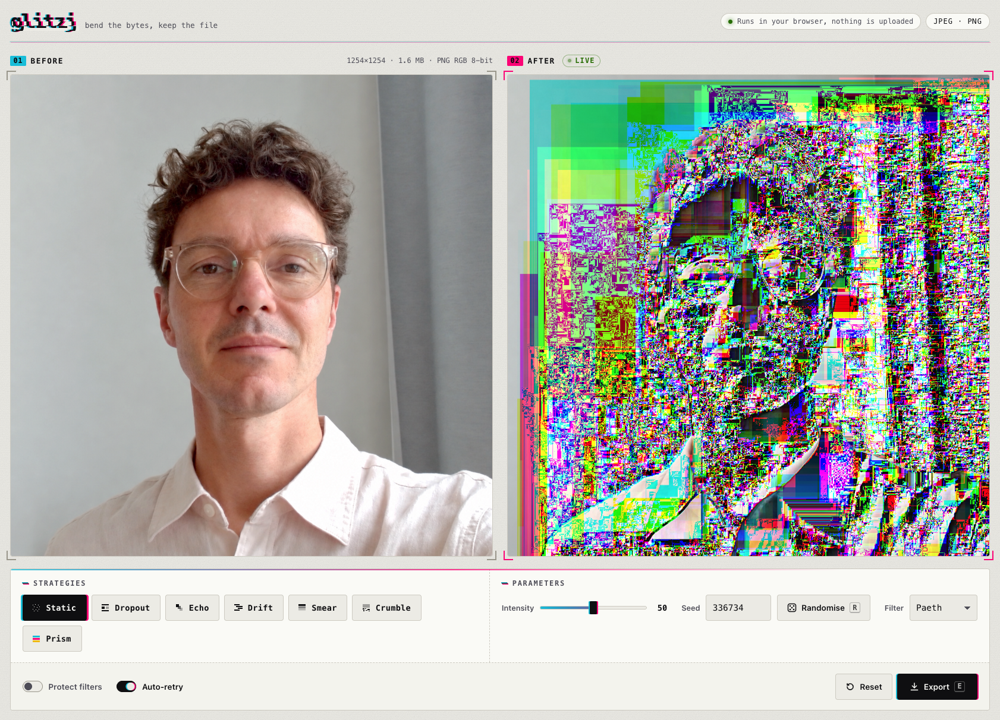

# Glitzj

A glitch tool for JPEG, PNG and GIF images that runs entirely in your browser. Nothing is uploaded; your photos never leave your machine.

**Try it at [y-a-v-a.github.io/glitzj](https://y-a-v-a.github.io/glitzj/).**

## What it does

A glitch is bent data: an image whose bytes have been deliberately damaged, yet still open in any viewer. JPEG suits this well. Its compressed picture data tolerates corruption and answers with color smears, torn rows, repeated bands and scattered noise. Glitzj damages only that picture data and leaves the file's structure intact, so every export is a real JPEG that opens anywhere.

PNG protects its picture data with checksums, so Glitzj goes one level deeper: it unpacks the rows of pixels, damages them, and packs them up again with fresh checksums. PNG stores each row as differences from neighboring pixels, so one damaged byte runs on as a streak, a smear or a block of color depending on the row's filter. Every export is a real PNG.

GIF compresses its pixels with LZW, which builds a dictionary of pixel runs as it goes and refers back to it with numbered codes. Glitzj damages those codes. A damaged code decodes to a different run of pixels, often a longer or shorter one, so everything after it tears and shifts sideways, and the dictionary entries built from it carry the damage on. Every frame of an animated GIF is glitched and the animation keeps playing. Every export is a real GIF.

## How to use it

1. Drop a JPEG, PNG or GIF onto the page, paste one from the clipboard (a screenshot works), or click the left panel to open a file.
2. Switch on one or more strategies. The right panel updates instantly.
3. Move the intensity slider to set how hard the effect hits.
4. Change the seed, or press Randomise, to reroll where the damage lands. The same image, seed and settings always give the same result.
5. Export when you like what you see.

Your settings are mirrored in the page address, so you can bookmark a look or send it to someone who has the same source image. Exported files carry the strategies, intensity and seed in their name.

## Strategies

- **Static** sprinkles noise across the whole image.
- **Dropout** blanks out contiguous runs, leaving solid patches.
- **Echo** repeats one block over its neighbors, producing bands.
- **Drift** shifts data forward, tearing and displacing rows.
- **Smear** corrupts early data for color bleeds and large-scale distortion.
- **Crumble** corrupts late data, destroying edges while the image stays recognizable.
- **Prism** (PNG and GIF) decodes random rows of a PNG with the wrong filter, giving bands of shifted color. On a GIF it shifts the colors of random palette entries.

Strategies combine freely. On PNG and GIF, early and late data are the top and bottom of the image.

### PNG filters

PNG predicts every byte from its neighbors, and the way it does so decides how damage spreads. The **Filter** control re-encodes the image with one filter before glitching; the picture itself does not change, only how it breaks:

- **None** keeps damage to single pixels.
- **Sub** streaks it sideways.
- **Up** streaks it downward.
- **Average** smears it diagonally.
- **Paeth** breaks it into blocks.

**Original** keeps whatever filters the file came with.

### Glitch a JPEG as PNG

Prefer the PNG look for a photo? With a JPEG loaded, switch on **Glitch as PNG**. Glitzj takes the picture as your browser shows it, turns it into a PNG in memory and glitches that, so the Filter control, Prism and the PNG-style streaks all apply. The export is then a PNG, which is larger than the JPEG it came from, and it carries no camera metadata. Switch it off to return to the JPEG glitch.

### GIF

On a GIF the strategies work on the LZW codes of each frame:

- **Static** swaps random codes for others, so the picture tears at each one and shifts sideways from there.
- **Dropout** turns runs of codes into single pixels. The picture loses the pixels those codes stood for, slides up, and the space left at the bottom rolls around to the top of the frame, like a TV losing its vertical hold.
- **Echo** repeats a run of codes, so fragments of the picture repeat.
- **Drift** shifts a run of codes forward, displacing the picture below it.
- **Smear** and **Crumble** damage the first or last codes: tears near the top that run on down, or damage near the bottom.
- **Prism** rotates the red, green and blue values of random palette entries, so every pixel in such a color changes hue. A photo squeezed into 256 colors spreads each tone over many entries, so this lays bare the bands its palette is built from. Grays have no hue to rotate and get split into colors instead. Colors that cover more of the picture are more likely to be picked.

In interlaced GIFs the early codes describe every eighth row, so damage spreads over the whole image in stripes.

Every frame of an animation gets its own random choices, so the glitch jumps around as it plays. Switch on **Steady** to make the same choices on every frame; the damage then tends to stay in place. Many animated GIFs only redraw the parts of each frame that change, so damage can linger on screen until something draws over it.

## Keeping results viewable

Damaged bytes can accidentally form control codes that make a decoder give up partway, leaving the lower part of the image flat gray. **Protect markers**, on by default, quietly repairs those codes so the whole glitch survives. Turn it off if you want the cut-off look. **Auto-retry** steps through seeds until one renders whenever a result breaks.

For PNG the same toggle reads **Protect filters**: it keeps each row's filter intact so the damage stays in the pixels. Without it, damaged filter bytes reinterpret whole stretches of the image, and an invalid one makes viewers disagree: in testing, Chrome stopped drawing at that row, Firefox showed nothing and the macOS image decoder behind Safari and Preview carried on. **Keep alpha**, on by default for images with transparency, restores the original transparency so damage changes colors instead of punching holes.

For GIF the toggle reads **Protect codes**. Viewers react very differently to damaged LZW data. In testing, Chrome stopped drawing at the first code it could not use and left the rest transparent; Firefox showed nothing at all for such a still image, while still reporting it as loaded; the macOS image decoder carried on. Protect codes replaces every code a viewer would give up on, makes every frame exactly as long as it should be, and keeps palette indices inside the palette. Chrome, Firefox and the macOS decoder then showed identical pixels in every test. Without it, the panel says how many frames viewers will cut off, since Firefox gives no sign of it.

## GIF dither

The second page, **GIF dither** (`gif.html`), does not glitch. It redraws any image your browser can open as a GIF with a small palette and lets you shape the dithering: the pattern of dots that fakes the colors the palette lacks.

- **Method**: error diffusion (Floyd–Steinberg, Atkinson, Jarvis–Judice–Ninke, Stucki, Burkes, Sierra, Sierra Lite) passes each pixel's rounding error on to its neighbors, giving a grainy, organic pattern. Ordered dither (Bayer 2 × 2, 4 × 4, 8 × 8) gives a regular crosshatch. Noise adds random jitter; change the seed to reroll it. Off maps every pixel to its nearest color, giving flat bands.
- **Strength** scales how much error or pattern is added. At 0 every method looks like Off.
- **Serpentine** runs every other row right to left, which breaks up the diagonal lines error diffusion can leave.
- **Colors from**: the image itself (a median-cut palette of 2 to 256 colors), grayscale or duotone with 2 to 256 levels, the 216 web-safe colors, or the 8 RGB primaries. Duotone dithers in gray and then paints the levels from your dark color to your light color. The − and + buttons beside the slider step one color at a time.
- **Dot size** makes every dot cover 1 to 16 pixels of the original in each direction. A GIF stores no DPI, only a width and height in pixels, so fewer pixels per inch means fewer pixels: at dot size 4 a 1600 px wide photo is dithered at 400 px and every dot shows as a 4 × 4 block.
- **Brightness** and **Contrast** are applied before dithering, so they change the dot pattern itself, not just the colors.
- **1:1** above the result shows it without scaling it down, so you see the dots as they are.

**Export at original size**, on by default, saves the GIF at the size of the original with each dot drawn as a block of pixels. Switch it off to save one pixel per dot. Pixels that are less than half opaque become transparent; GIF has no partial transparency. An animated GIF is dithered as a still of its first frame. Settings are mirrored in the page address here too.

## Limits

JPEG, PNG and GIF, up to 10 MB and 4000 × 4000 pixels; for PNG the unpacked picture data may be at most 64 MB, which a 16-bit 4000 × 4000 image exceeds, and a GIF's frames may add up to at most 200 million pixels. Animated PNGs are glitched as a still of their first frame; animated GIFs keep all their frames. Very large files would freeze the page.

## Running it

There is nothing to install or build. Serve the folder that contains index.html with any static web server and open it in a modern browser.

Every push to `main` runs the tests and publishes the `webapp` folder to GitHub Pages.

---

© 2026 Vincent Bruijn
