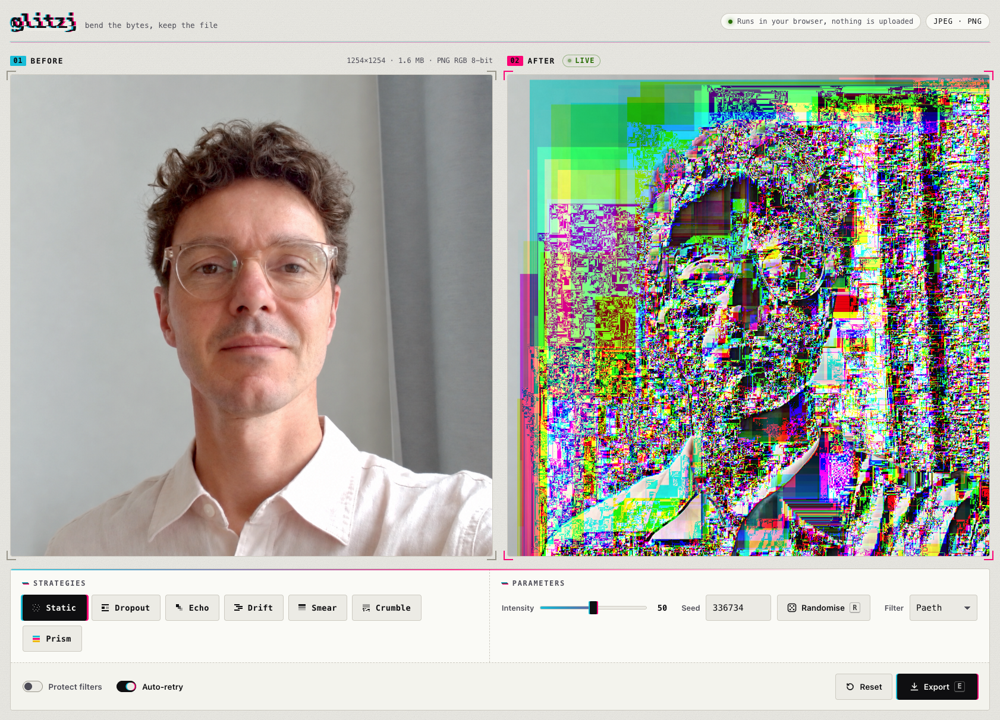

# Glitzj

A workshop for breaking images on purpose, running entirely in your browser. Nothing is uploaded; your photos never leave your machine.

**Try it at [y-a-v-a.github.io/glitzj](https://y-a-v-a.github.io/glitzj/).**

None of the ten tools paints an effect on top of a picture. Each one takes a real mechanism (a file format, a sorting algorithm, a printing press, a tape recorder, a television) and uses it wrongly, so what you see is what that mechanism does when it goes wrong.

| | |
|---|---|
| [**Glitch**](docs/GUIDE.md#glitch) | damage the bytes of a JPEG, PNG or GIF and keep the file valid |
| [**GIF dither**](docs/GUIDE.md#gif-dither) | redraw a picture in a handful of colors and shape the dots |
| [**JPEG crush**](docs/GUIDE.md#jpeg-crush) | compress down to quality 0, again and again |
| [**JPEG surgery**](docs/GUIDE.md#jpeg-surgery) | operate on the numbers inside a JPEG, then lie in its header |
| [**Split**](docs/GUIDE.md#split) | pull the color planes of a picture apart with your hands |
| [**Sort**](docs/GUIDE.md#sort) | run a sorting algorithm over the pixels and pull the plug halfway |
| [**Bend**](docs/GUIDE.md#bend) | play the picture through audio effects, and listen to it |
| [**Misread**](docs/GUIDE.md#misread) | read the right bytes with the wrong width, format or alignment |
| [**Signal**](docs/GUIDE.md#signal) | send the picture as analog television and receive it badly |
| [**Mosh**](docs/GUIDE.md#mosh) | apply the motion of a video to a still, over and over, with no keyframe |

## How it goes

1. Drop an image onto any page, paste one from the clipboard, or click the left panel to open a file.
2. Move things. The result on the right updates as you go, and the same image and settings always give the same result.
3. Press **Feed back** to make the result the new source, and carry it to the next tool: sort it, send it through the television, crush what arrives.
4. **Export** the file as made, or at another size or in another format.

Before any of that you can turn, mirror and zoom the original, which changes what every tool does to it. Settings live in the page address, so a look can be bookmarked or sent to someone.

## Read more

- [**Guide**](docs/GUIDE.md): what every tool does and what every control is for, plus the limits on file size.
- [**Spec**](docs/SPEC.md): how it is built, pipeline by pipeline.

## Running it

There is nothing to install or build. Serve the `webapp` folder with any static web server and open it in a modern browser. `npm test` runs the tests.

Every push to `main` runs the tests and publishes the `webapp` folder to GitHub Pages.

---

© 2026 Vincent Bruijn
